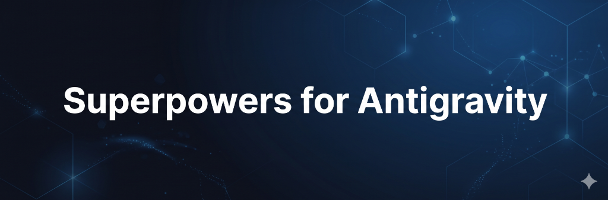

<p align="center">
  
</p>

<p align="center">
  <strong>A complete software development methodology for your coding agent.</strong><br>
  Composable skills that trigger automatically — your agent just has Superpowers.
</p>

<p align="center">
  <a href="https://github.com/roundpilot/superpowers-antigravity#-installation"></a>
  <a href="RELEASE-NOTES.md"></a>
  <a href="https://github.com/obra/superpowers"></a>
  <a href="LICENSE"></a>
</p>

---

> **This is a fork of [obra/superpowers](https://github.com/obra/superpowers) rebuilt natively for [Google Antigravity 2.0](https://antigravity.google).** If you need multi-platform support (Claude Code, Codex, Cursor, etc.), use the upstream repo instead.

---

## ✨ How It Works

It starts from the moment you fire up your coding agent. As soon as it sees that you're building something, it *doesn't* just jump into trying to write code. Instead, it steps back and asks you what you're really trying to do.

How much ceremony follows depends on what you asked for. It classifies the request out loud — a feasibility probe, a bounded change to code that already exists, or something architectural — and only the last of those earns a written spec, shown to you in chunks short enough to actually read and digest. The smaller paths get a couple of sentences in chat instead. What never scales down is the approval: nothing gets built until you say yes.

After you've signed off on the design, your agent puts together an implementation plan that's clear enough for an enthusiastic junior engineer with poor taste, no judgement, no project context, and an aversion to testing to follow. It emphasises true red/green TDD, YAGNI (You Aren't Gonna Need It), and DRY.

Next up, once you say "go", it launches a *subagent-driven-development* process, having agents work through each engineering task, inspecting and reviewing their work, and continuing forward. It's not uncommon for agents to work autonomously for a couple hours at a time without deviating from the plan you put together.

There's a bunch more to it, but that's the core of the system. And because the skills trigger automatically, you don't need to do anything special. Your coding agent just has Superpowers. (See [Activation](#-activation) for how the loading works — and how to scope it if you don't want it everywhere.)

## 🔀 What's Different from Upstream?

The original superpowers supports 9+ platforms via a tool mapping abstraction layer — skills are written with Claude Code tool names, and per-platform reference files translate at runtime.

This fork **removes the abstraction entirely**. All skills use native Antigravity 2.0 tool names directly (`view_file`, `run_command`, `invoke_subagent`, `define_subagent`, etc.), eliminating translation overhead and making every skill read exactly as the agent will execute it.

<details>
<summary><strong>Why remove cross-platform support?</strong> (click to expand)</summary>

The abstraction layer costs tokens on every interaction, and those costs compound across a session:

1. **Tool mapping file loaded every session.** The upstream approach loads a ~500-token tool mapping reference into context at session start. Every turn carries this translation table. This fork eliminates it entirely.

2. **Agent reasoning overhead.** When a skill says "use the Bash tool," the agent must look up the mapping, reason about which native tool to call, and potentially make mistakes. When skills say `run_command` directly, there's zero translation cost.

3. **Platform-conditional branching in skills.** The upstream `using-superpowers` skill has separate instruction blocks for Claude Code, Copilot CLI, Gemini CLI, Codex, Antigravity 2.0, and "other environments." Only one applies.

4. **87 fewer files than upstream (as of v6.3.0 on both sides).** When agents explore the repo, fewer files means less noise in `list_dir` output and faster orientation.

5. **Leaner skills without platform detection.** No harness-detection or fallback branches inside skills — `using-git-worktrees` is 120 lines to upstream's 167 (as of v6.3.0). Shorter skills = less context consumed.

</details>

### Comparison Table

| Area | Upstream (obra/superpowers) | This fork |
|------|---------------------------|-----------| 
| **Platforms** | 9+ (Claude Code, Codex, Cursor, etc.) | Antigravity 2.0 only |
| **Tool names in skills** | Claude Code names + mapping files | Native Antigravity names |
| **Subagent dispatch** | `Task tool (general-purpose)` | Bundled custom agents + `invoke_subagent` |
| **Workspace isolation** | `git worktree` with fallback | Native `Workspace: "branch"` / `"share"` / `"inherit"` |
| **Task tracking** | `TodoWrite` tool | `task.md` artifacts |
| **Visual brainstorming** | Browser-based server | Native `generate_image` (no server needed) |
| **Plan formatting** | Plain markdown | Mermaid diagrams, file links, diff blocks, GitHub alerts |
| **Background tasks** | Not documented | `manage_task`, `send_message`, `schedule` (incl. cron) |
| **UI verification** | Not available | `browser-testing` skill with screenshot evidence |
| **Read-only subagents** | Full tool set for all | Bundled read-only reviewer agents (plus `TypeName: "research"` ad-hoc) |
| **Web research** | Not guided | `search_web` + `read_url_content` integrated |

### Core Enhancements

Beyond the platform port, this fork adds capabilities that don't exist upstream:

- 🎨 **`generate_image` in brainstorming** — native mockup generation with carousel comparisons
- 📐 **Rich plan formatting** — Mermaid architecture diagrams, clickable `file:///` links, diff blocks
- 🔄 **Async subagent coordination** — `manage_task` for builds, `send_message` mid-flight, `schedule` for timeouts
- 🌐 **Browser-testing skill** — evidence-before-assertions discipline for UI work
- 💰 **Token-saving subagents** — reviewers are read-only bundled agents (`TypeName: "research"` for ad-hoc review)
- ✅ **Automatic feedback loops** — `RequestFeedback: true` (in `ArtifactMetadata`) on design docs and plans
- 🔀 **Workspace mode guidance** — decision tables for `branch` / `inherit` / `share` per role
- 🛡️ **Edit-time purity gate** — a `PreToolUse` hook blocks banned legacy vocabulary from entering this plugin's `skills/` before a write ever lands (opt-in for contributors: rename `hooks.example.json` → `hooks.json`; requires `bash` available to the hook runner)
- 🔍 **Web research integration** — `search_web` woven into debugging, brainstorming, and planning

## 🚀 The Workflow

```
 ┌─────────────┐     ┌──────────────┐     ┌───────────────┐     ┌──────────────────────────┐
 │ Brainstorm  │ ──▶ │ Write Plan   │ ──▶ │ Create Branch │ ──▶ │ Subagent-Driven Dev      │
 │             │     │              │     │               │     │  ┌────────┐ ┌──────────┐ │
 │ • Questions │     │ • Tasks      │     │ • Isolated    │     │  │Implement│▶│  Review  │ │
 │ • Mockups   │     │ • Diagrams   │     │ • Clean base  │     │  └────────┘ └──────────┘ │
 │ • Design    │     │ • Specs      │     │ • Tests pass  │     │       ↺ per task         │
 └─────────────┘     └──────────────┘     └───────────────┘     └──────────────────────────┘
                                                                             │
                                                                             ▼
                                                                ┌──────────────────────────┐
                                                                │   Finish Branch          │
                                                                │  • Final review          │
                                                                │  • Merge / PR / Keep     │
                                                                └──────────────────────────┘
```

1. **brainstorming** — Classifies the request (spike / bounded / architectural), then refines it through questions, explores alternatives, generates visual mockups
2. **using-git-worktrees** — Isolates the session on a feature branch; concurrent writing subagents get native `Workspace: "branch"`
3. **writing-plans** — Breaks work into bite-sized tasks with exact file paths and verification steps
4. **subagent-driven-development** - Fresh subagent per task with two-stage review (spec compliance + code quality)
5. **test-driven-development** — RED-GREEN-REFACTOR: write failing test → minimal code → pass → commit
6. **requesting-code-review** — Reviews against plan, reports issues by severity
7. **finishing-a-development-branch** — Verifies tests, presents merge/PR/keep options

**Skills trigger automatically.** Mandatory workflows, not suggestions.

## 📦 Installation

### Antigravity CLI (`agy`)

One command, straight from GitHub:

```bash
agy plugin install https://github.com/roundpilot/superpowers-antigravity
```

Manage with `agy plugin list` / `agy plugin enable superpowers` / `agy plugin disable superpowers`.

> The CLI and the IDE keep independent plugin stores — installing into one does not install into the other.

### Antigravity 2.0 IDE (desktop app)

The IDE loads plugins from its config directories — clone this repo into one:

#### macOS / Linux

**Global plugin** (available in all projects):
```bash
git clone https://github.com/roundpilot/superpowers-antigravity ~/.gemini/config/plugins/superpowers
```

**Workspace plugin** (project-level only):
```bash
git clone https://github.com/roundpilot/superpowers-antigravity .agents/plugins/superpowers
```

**Update later:**
```bash
cd ~/.gemini/config/plugins/superpowers && git pull
```

#### Windows (PowerShell)

**Global plugin** (available in all projects):
```powershell
git clone https://github.com/roundpilot/superpowers-antigravity "$env:USERPROFILE\.gemini\config\plugins\superpowers"
```

**Workspace plugin** (project-level only):
```powershell
git clone https://github.com/roundpilot/superpowers-antigravity .agents\plugins\superpowers
```

**Update later:**
```powershell
cd "$env:USERPROFILE\.gemini\config\plugins\superpowers"; git pull
```

#### Windows (WSL)

If you run Antigravity inside WSL, use the Linux paths above.

If you run the **Windows Antigravity IDE** but your workspace is in **WSL**:

```bash
# Global plugin (installed on Windows side):
git clone https://github.com/roundpilot/superpowers-antigravity /mnt/c/Users/$USER/.gemini/config/plugins/superpowers

# Workspace plugin (inside your WSL workspace):
git clone https://github.com/roundpilot/superpowers-antigravity /path/to/your/wsl/project/.agents/plugins/superpowers
```

#### Manual IDE installation (no git required)

<details>
<summary>Download ZIP instead of cloning (click to expand)</summary>

**macOS / Linux:**
```bash
curl -L https://github.com/roundpilot/superpowers-antigravity/archive/refs/heads/main.zip -o superpowers.zip
unzip superpowers.zip
mkdir -p ~/.gemini/config/plugins
mv superpowers-antigravity-main ~/.gemini/config/plugins/superpowers
rm superpowers.zip
```

**Windows (PowerShell):**
```powershell
Invoke-WebRequest -Uri "https://github.com/roundpilot/superpowers-antigravity/archive/refs/heads/main.zip" -OutFile superpowers.zip
Expand-Archive superpowers.zip -DestinationPath .
New-Item -ItemType Directory -Force -Path "$env:USERPROFILE\.gemini\config\plugins"
Move-Item superpowers-antigravity-main "$env:USERPROFILE\.gemini\config\plugins\superpowers"
Remove-Item superpowers.zip
```

To update later, delete the `superpowers` folder and repeat the steps above.

</details>

#### Migrating an IDE install from `roundpilot/superpowers`

If you previously installed from `roundpilot/superpowers`, update your remote:

```bash
cd ~/.gemini/config/plugins/superpowers
git remote set-url origin https://github.com/roundpilot/superpowers-antigravity.git
git pull
```

### ✅ Verify Installation

1. Start a new Antigravity session in any project
2. Type `/using-superpowers` (or `/superpowers:using-superpowers` for the CLI) — the bootstrap loads for the session
3. Alternatively, ask: "What superpowers skills do you have available?" — the agent should enumerate skills from this plugin
4. Say "Let's make a react todo list"
5. The brainstorming skill should trigger automatically — the agent asks design questions instead of writing code

> The slash form isn't on the documented slash-command surface (that page covers workflows), but it works in practice — the palette also surfaces skills. If it ever stops resolving, steps 3-5 are the fallback check.

## 🔌 Activation

Once installed, the methodology loads itself — no per-session setup:

- **Automatic (default).** The plugin's context file loads the `using-superpowers` bootstrap into every session, and the bundled rule (`rules/using-superpowers.md`) does the same through Antigravity's rule system — check the Rules panel once after installing and set it to **Always On** if it isn't already. From there, individual skills trigger themselves based on what you ask for: describe a feature and brainstorming starts, report a bug and systematic-debugging starts.
- **Per session.** Type `/using-superpowers` (IDE) or `/superpowers:using-superpowers` (CLI) to load the methodology for just the current conversation.
- **Scoped, if you don't want it everywhere.** Install as a **workspace plugin** (`.agents/plugins/superpowers`) so only chosen projects get it — or set the bundled rule to **Manual** in the Rules panel and summon it on demand with the slash command when a session calls for it.

The always-loaded footprint is a single compressed bootstrap (~55 lines); individual skills are read only when they actually trigger.

## 📚 Skills Reference

### Testing & Verification
| Skill | Purpose |
|-------|---------|
| **test-driven-development** | RED-GREEN-REFACTOR cycle with the `writing-good-tests` reference (falsifiability rules + mutation check) |
| **browser-testing** | Evidence-before-assertions for UI work (screenshot → DOM inspect → embed proof) |

### Debugging
| Skill | Purpose |
|-------|---------|
| **systematic-debugging** | 4-phase root cause process with `search_web` for unfamiliar errors |
| **verification-before-completion** | Ensure it's actually fixed; cron schedules for long test suites |

### Collaboration
| Skill | Purpose |
|-------|---------|
| **brainstorming** | Three-path router (spike / bounded / architectural) so ceremony scales to the task; Socratic refinement with `generate_image` mockups and `search_web` for prior art |
| **writing-plans** | Detailed plans with Mermaid diagrams, rich formatting, `RequestFeedback`, and a `Spec:` pointer so the spec travels with the plan |
| **executing-plans** | Inline plan execution with walkthrough generation |
| **dispatching-parallel-agents** | Concurrent workflows with `Workspace: "share"` and monitoring |
| **requesting-code-review** | Bundled `code-reviewer` dispatches with severity classification (`research` for lightweight ad-hoc reviews) |
| **receiving-code-review** | Responding to feedback with technical rigor |
| **using-git-worktrees** | Workspace isolation with mode decision table |
| **finishing-a-development-branch** | Merge/PR decision workflow |
| **subagent-driven-development** | Fast iteration with two-stage task review and async coordination; resume-based fix loop with five-round cap; records rulings instead of stalling, and batches small same-shape tasks into one dispatch |

### Meta
| Skill | Purpose |
|-------|---------|
| **writing-skills** | Create new skills following best practices |
| **using-superpowers** | Introduction to the skills system |

## 🧭 Philosophy

- **Test-Driven Development** — Write tests first, always
- **Systematic over ad-hoc** — Process over guessing
- **Complexity reduction** — Simplicity as primary goal
- **Evidence over claims** — Verify before declaring success

## 🤝 Contributing

See [CONTRIBUTING.md](CONTRIBUTING.md) for contribution guidelines, PR requirements, and quality standards.

## 📜 License

MIT License — see [LICENSE](LICENSE) for details.

## 🙏 Acknowledgements

This project is a fork of [obra/superpowers](https://github.com/obra/superpowers). If Superpowers has helped you, consider [sponsoring the original project](https://github.com/sponsors/obra).
