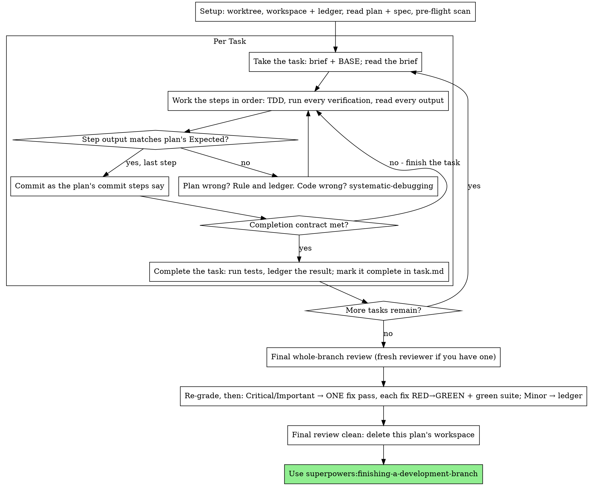

# Executing Plans

Execute the plan yourself, task by task, in this session: no implementer
subagent per task, no reviewer per task. One fresh-context review of the
whole branch at the end.

**Why inline:** Subagent-driven development pays for a fresh implementer
and a fresh reviewer on every task, each re-reading the codebase from zero.
Inline execution pays for one context (yours) plus one reviewer at the end.
What it gives up is a fresh context per task and a second pair of eyes per
task. This skill keeps what those two things bought, by other means: the
brief is the spec, the ledger is your memory, TDD is the per-task gate, and
the final reviewer is the second pair of eyes.

**Core principle:** The plan already did the thinking. Execute it exactly,
prove each step with a test you watched fail and then pass, and leave a
record that survives your own forgetting.

**Narration:** between tool calls, narrate at most one short line — the
ledger and the tool results carry the record.

**Continuous execution:** Do not pause to check in with your human partner
between tasks. They chose inline execution to spend less, not to answer
"should I continue?" after every task. Execute all tasks from the plan
without stopping.

**Rulings, not stalls.** Conflicts, ambiguities, plan defects — decide them.
The spec is the binding authority, the plan is its argument, and your
judgment settles what neither answers. Record every decision in the ledger
as `Ruling: <what you decided> — <why> — <what it costs if wrong>`, and keep
going. Deviating from the plan without a ledgered ruling is a decision made
in secret.

Four things stop you, and only these: an irreversible or destructive
operation; a security-sensitive action; a side effect outside this worktree
that norms say you ask about first (a merge, a push to a shared branch, a
publish); and a plan so broken that every path forward is a guess. For
those, stop and ask.

Your human partner may steer while the plan runs — a message, a comment on the plan or another artifact, stopping a subagent you dispatched, or, in subagent-driven development, an instruction sent straight to an implementer (a CLI `@` message) that its report mentions. That is their instruction, not your ruling: apply it, ledger it as `Task <N>: partner instruction: <one-liner>`, and rule only where it conflicts with work already finished. One that changes scope or asks you to stop — a stopped subagent is one — is handled like the four stops.

## When to Use

- You have a plan from superpowers:writing-plans and your human partner
  chose inline execution at the handoff.
- Your harness has no subagent tool, or the plugin's bundled agents do not resolve in it. Never fabricate a dispatch; run the plan here.
- Tasks are mostly independent — the same precondition as
  superpowers:subagent-driven-development.

A fully specified plan makes inline execution transcription plus testing:
it runs well on a mid-tier session model, and the one place the most
capable model earns its cost is the final review, which this skill
dispatches separately. Tell your human partner so when they choose inline.

Prefer superpowers:subagent-driven-development when your human partner
wants a review gate on every task, or when the plan is long enough that
its later tasks would run on a compacted context. Inline execution over a
long plan still works — the ledger is what makes it recoverable — but the
last tasks get the least of you.

## The Process



## Setup

Ensure the work happens in an isolated workspace: use
superpowers:using-git-worktrees to create one or verify the existing one.
Never start implementation on a main/master branch without your human
partner's explicit consent.

Approvals can pause an unattended run. If your commands run in a terminal sandbox, a commit may need to run outside it — the sandbox can keep `.git` read-only — and that waits for your human partner's approval unless an allow rule covers it; where their settings review commands or edits, more waits. Before Task 1, tell your human partner in one line what may wait for approval: the git commands you and your reviewers run on every task (`git rev-parse`, `git rev-list`, `git merge-base`, `git diff`, `git log`, `git status`), the plan's test commands, `git add` and `git commit`, and — where edits pause for review — every file edit. Never change their permission settings yourself. This is a notice, not a stop: start Task 1.

Conversation memory does not survive compaction. An inline executor that
loses its place re-implements tasks whose commits already exist — the same
failure as a controller re-dispatching them, paid for in your own context.
Track progress in a ledger file, not only in the task.md artifact. The task.md artifact is a live view; the ledger is the record.

The workspace and ledger are shared with superpowers:subagent-driven-development
— same directory, same format — so a plan can change executors mid-flight
and the new one resumes from the same ledger.

- Each plan owns a workspace: a git-ignored directory under `<repo-root>/.superpowers/sdd/`, home to every file for THIS plan — its ledger. Another plan's directory is never yours to read or write. Resolve it at skill start:
  1. Write the plan's path the way the ledger names it: relative to the repository root (`git rev-parse --show-toplevel`), with forward slashes, or absolute if the plan lives outside the repository. Normalize a ledger's first line the same way before you compare it, and on Windows compare without regard to case.
  2. Try `.superpowers/sdd/<plan-basename>/`, then `<plan-basename>-<name of the plan's parent directory>/`, then that name with `-2`, `-3`, … appended. A candidate is yours if it has no `progress.md`, or if its `progress.md` first line names your plan; one whose first line names another plan belongs to that plan — try the next.
  3. Create and extend files here with your file tools, never with shell redirection: create `progress.md` with `write_to_file`, and append each ledger line with `replace_file_content` anchored on the ledger's current last line — never rewrite the whole ledger. If a directory is missing, create each level with the shell's own command and retry. Then, if `<repo-root>/.superpowers/.gitignore` does not exist, create it with the single line `*`.
  4. If the platform refuses to read or write the ledger (the IDE's strict mode hides git-ignored files), keep the ledger in the task.md artifact instead; if that is refused too, keep the ledger lines in your messages. Either way, tell your human partner at the start that another executor, or another conversation, cannot resume from it.
- Check for this plan's ledger at `<workspace>/progress.md`. If its first
  line names your plan file, tasks with a `Task <N>: complete` line are
  DONE — do not redo them; resume at the first task without one. Their
  commits exist in git even when your context no longer remembers making
  them: after compaction, trust the ledger and `git log` over your own
  recollection. A ledger whose first line names a different plan file is
  another plan's progress: leave it and start your own, fresh.
- Create the ledger with its identity as the first line:
  `# SDD ledger — plan: <plan file path>`.
- `git clean -fdx` will destroy the workspace (it's git-ignored scratch);
  if that happens, recover from `git log`.
- A task whose last line is a `dispatched` line or a fix round was mid-loop under superpowers:subagent-driven-development, and its implementer may still be running in this checkout. If you have a subagent tool, list your subagents (`manage_subagents`) and stop that implementer before you touch the task; if it is not in your list, ask your human partner once whether it has stopped. Its commits after the ledgered base are work done: read them (`git log`) and build on them — do not redo them.

Read the plan once, note its context and Global Constraints, and create a task.md artifact (`write_to_file` with `IsArtifact: true` and the task type in `ArtifactMetadata`) with one line per task — it belongs with your other artifacts, never in the repository or under `scratch/`. Ledger the plan map — `Plan map: Task 1 L<first>-<last>; Task 2 L<first>-<last>; …` — from the lines where the plan's task headings start: from your read, or from `git grep -n --no-index -E "^#+[[:space:]]+Task[[:space:]]+[0-9]+" -- <plan>`, ignoring matches inside code fences. If the plan file changes during the run, map it again and ledger the new map.
If the plan names a Spec, read that too: the spec is the
authority the plan argues from, and conflicts inside the plan resolve
against it. A plan with no reachable spec gets a ledger note saying so —
rulings made without one are provisional.

**REQUIRED SUB-SKILL:** load superpowers:test-driven-development now,
before Task 1. It governs every step of every task below; a plan whose
steps already say "write the failing test first" does not exempt you
from reading it.

Before Task 1, scan the plan for conflicts between tasks. The plan's
Interfaces blocks tell you where to look: for every task that consumes
what an earlier task produces, one ledger row — the two tasks, what one
produces against what the other consumes, and what you found. Tasks that
share nothing get no row; a plan whose tasks share nothing gets the single
line `Pre-flight: no shared interfaces`. Rule on each conflict a row
surfaces with the spec as the binding authority, record the ruling beside
its row, and start Task 1. Each task's own text is checked when you read
its brief, not here.

## The Task Loop

Everything you print, and every tool result, stays resident in your context for the rest of the session. Keep long test output out with the test runner's own quiet or summary option, not by redirecting it into a file: redirecting the error stream can make the command wait for approval, and redirection differs between the shells your commands may run in. Read a brief, not the whole plan.

### 1. Take the task

- In one step, read the task's brief — its section of the plan — with `view_file` (`StartLine` and `EndLine` from the plan map), and run `git rev-parse HEAD` for BASE (the commit the task's range is cut from). Read the brief for every task, including ones you remember from setup: what you remember is a summary, the brief has the exact values, signatures, and test cases.
- Mark the task in_progress in the task.md artifact.

Every tool call is a turn that re-reads your whole context. Bookkeeping rides along with work — make a ledger or task.md edit in the same step as the work that follows it (Task N's completion line goes out with Task N+1's brief read), never in a step of its own.

### 2. Work the steps

The plan's steps are already in RED-GREEN order; follow them in that
order under superpowers:test-driven-development, loaded at setup. A test
step's code is written first and run first. Watching it fail is a step,
not a formality — a test that passes before the implementation exists is
a finding about the test.

Every step that runs a command has an `Expected:` line. Run the command,
read its output, and compare. Three outcomes:

- **Matches.** Next step.
- **The code is wrong.** Use superpowers:systematic-debugging. Find the
  cause; never patch the symptom to make the step's output match.
- **The plan is wrong** — a step contradicts the spec, an interface from an
  earlier task doesn't match what this task consumes, a command that
  cannot work. Rule on the smallest change that satisfies the spec, ledger
  it as `Task <N>: Ruling: <finding> — <what you decided and why>`, and
  continue. The ruling is carried, not remembered: later tasks that touch
  the same interface read it from the ledger.

Commit as the plan's commit steps say. A task that spans several commits
is fine; BASE is what the review range is cut from, never `HEAD~1`.

### 3. The completion contract

Before a task's ledger line, all of the following are true, with evidence
in this session — not inferred from the diff looking right:

- Every test the brief names exists and ran in this task, and you read
  the output.
- The final test run for the task passed — step 4's run is that run, and its command and result go into the ledger line.
- Every `Expected:` line in the brief was compared against real output.
- Every deviation from the brief has a `Ruling:` line in the ledger.

**REQUIRED SUB-SKILL:** superpowers:verification-before-completion governs
the claim. If any item is missing, the task is not complete: finish it.

### 4. Complete the task

Run the test command the brief names for the whole task with `run_command` (`Cwd`: the repository root, and a `WaitMsBeforeAsync` long enough for the suite's expected run, so its result comes back in the same call) and, in the same step, `git rev-parse HEAD`. Read the result. If the run outlasts its `WaitMsBeforeAsync` anyway, it moves to the background: collect it with `manage_task` (`Action: "status"`), pacing your checks with a one-shot `schedule` timer rather than a tight loop, and record nothing while it runs; a result you cannot read is not a pass. Only if it passed — its exit status, where your shell reports one, and the runner's own summary — append the completion line to the ledger:

`Task <N>: complete (commits <base7>..<head7>, tests: <command> → <result>)`

`<base7>` and `<head7>` are the first seven characters of BASE and of the HEAD you just read; `<result>` is the runner's final summary line. A test command that passes and prints nothing is recorded as tests: <command> → (no output); never leave it unrecorded.

A failing run records nothing; the task is not complete. When it records, mark the task complete in the task.md artifact and take the next task.

## Final Review

Compute MERGE_BASE — the commit the branch started from, `git merge-base <base-branch> HEAD` (e.g. `git merge-base main HEAD`) — and check the range before the review starts: `git rev-list --left-right --count MERGE_BASE...HEAD` must print `0` and then a number above `0`. If it prints anything else, do not start the review: find where the commits went first.

**With a subagent tool:** dispatch the reviewer on the most capable
available model — the whole-branch review is a judgment task — using
superpowers:requesting-code-review's
[code-reviewer.md](../requesting-code-review/code-reviewer.md), with the
package path, the plan and spec paths, the plan's Review Focus section
verbatim if it has one (the input classes and failure modes the plan's
tests do not exercise — the reviewer checks each deliberately), and a
pointer to the ledger's `Ruling:` lines so it can weigh the calls you
made. Specify the model
explicitly; an omitted model inherits the session's, which may not be the
most capable. This is the one fresh context the whole run buys. Do not
skip it, and do not replace it with your own read of the diff.

**Without a subagent tool:** read code-reviewer.md and perform that review
yourself against the package, as a separate pass after the last task's
ledger line. Write `Final review: self-review (no subagent tool)` to the
ledger, and say so in your final message: a self-review by the author is
weaker than a fresh reviewer, and your human partner decides whether that
is enough before merge.

Sort the findings before you act on any of them. The reviewer's severity
labels are advice; the gate is yours. Its "Declined to judge" list is
yours too: every line there is a ruling you make and ledger, exactly like
a plan conflict — `Final: Ruling: <behavior the reviewer set aside> —
<what a reasonable person using this software gets, and why that stands
or why it is now a finding> — <cost if wrong>`. Re-grade first, by effect: the
spec is a vision document, and a finding's grade is what a reasonable
person using this software gets if it ships, not whether the spec names
the input that triggers it — a reviewer who set a finding at Minor
because the spec was silent has graded the spec, not the effect. Then:

- **Critical and Important** enter the fix pass.
- **Minor** goes to the ledger as `Final: minor (deferred): <one-liner>`
  and to your final message under "Deferred minors". Minors never enter
  the fix pass, and never become rulings — a ruling is a decision about a
  conflict, not a note that you declined a polish suggestion.

Fix the Critical and Important findings yourself — you are the
implementer here — in ONE pass. Each fix is verified by TDD, not by a
second reviewer: write the test that reproduces the finding, watch it
fail, make it pass, then run the whole suite. Record each in the ledger as
`Final: fixed <finding> — <test name> RED→GREEN, suite <N>/<N>`. A fix
without a test that failed first is not verified; a suite that is not
green after the pass means the pass is not over. Do not dispatch a
re-review: it would re-read a diff whose covering tests already answer
"addressed" and whose suite run already answers "broke nothing".

A finding you decide not to fix is a ruling — `Final: Ruling: <finding> —
<why the code stands> — <cost if wrong>` — and reaches your human partner
in the rulings list. There is no second fix pass.

## Finish

Before you delete anything, collect every ledger line containing
`Ruling:` into your final message under "Rulings I made", in the order you
made them, each with what it costs if wrong, and every `minor (deferred)`
line under "Deferred minors". Both lists are exhaustive. Your final
message is the only place the decisions you took on your human partner's
behalf — and the findings you chose not to act on — reach them.

When the final review is clean and its fixes are committed, delete this
plan's workspace directory — the git history is the record now. Sibling
directories belong to other plans; leave them alone.

Use superpowers:finishing-a-development-branch.

## Common Rationalizations

| Excuse | Reality |
|--------|---------|
| "I remember what Task N says" | You remember a summary. The brief has the exact values. Read it. |
| "The plan's code is right, skip watching the test fail" | A test you never saw fail proves nothing. It is one step. Run it. |
| "I'll run the full suite at the end instead of per step" | Per-step runs are how you learn which step broke it. The end-of-task run is the contract, not a substitute. |
| "The plan is wrong here, I'll just do the right thing" | Do the right thing and ledger the ruling. Unledgered deviation is a decision made in secret. |
| "I'll write the ledger lines after a few tasks" | Compaction does not wait for a convenient moment. One line per task, riding with your next step. |
| "Let me check in before the next task" | They chose inline to spend less. Progress prompts spend their time instead. Only the four stops stop you. |
| "I read my own diff carefully; the final reviewer is redundant" | Same author, same blind spots. The reviewer is the only fresh context this run buys. |
| "Tests should pass, the change was trivial" | "Should" is not evidence. The contract requires the command and its output. |
| "Subagents are slow and expensive, I'll skip the final review too" | Inline already removed the per-task reviewers. One review of the whole branch is the floor, not the ceiling. |
| "The reviewer said Minor, so it's Minor" | The label graded the spec's silence. Grade what the person gets. Re-grade, then gate. |
| "The fix is obvious, no need for a failing test first" | The failing test is the only proof the finding was real and is now gone. Without it you have a diff and a hope. |
| "I'll fix the minors too while I'm in there" | Every minor you fix is a test, a fix, and a suite run your partner did not ask for. Ledger them; your partner decides. |

## Example Workflow

```
You: I'm using the executing-plans skill to implement this plan inline.

[Setup: worktree verified]
[Read plan once: docs/superpowers/plans/feature-plan.md; spec read]
[Resolve workspace: .superpowers/sdd/feature-plan/ — no ledger inside, fresh start; ledger created]
[Ledger: Plan map: Task 1 L31-58; Task 2 L59-97; …]
[Pre-flight scan: 2 shared-interface rows, 4 self-consistency rows, clean; written to ledger]
[Create task.md artifact with all tasks]

Task 1: Hook installation script

[Read Task 1's brief (view_file L31-58); git rev-parse HEAD → BASE a1b2c3d]
[Step 1: write failing test — written]
[Step 2: run it — FAIL: install_hook not defined. Matches Expected.]
[Step 3: implement — written]
[Step 4: run it — PASS 1/1. Matches Expected.]
[Step 5: commit — d4e5f6a]
[Contract: tests ran, output read, no deviations]
[run_command npm test -- hooks → PASS 1/1; HEAD d4e5f6a]
[Ledger, with Task 2's brief read: Task 1: complete (commits a1b2c3d..d4e5f6a, tests: npm test -- hooks → 1/1 pass)]

Task 2: Recovery modes

[Read Task 2's brief (view_file L59-97); git rev-parse HEAD → BASE d4e5f6a]
[Step 2: run failing test — FAIL, but on an import error: Task 1 exported
 installHook, brief consumes install_hook]
[Ruling: brief's consumer name is a typo against Task 1's Produces block;
 use installHook — Ledger: Task 2: Ruling: install_hook → installHook — matches Task 1 Produces — cost if wrong: one rename]
[Steps 2-5 as planned; commit b7c8d9e]
[run_command npm test -- recovery → PASS 8/8; HEAD b7c8d9e]
[Ledger, with the next step: Task 2: complete (commits d4e5f6a..b7c8d9e, tests: npm test -- recovery → 8/8 pass)]

...

[After all tasks: MERGE_BASE = git merge-base main HEAD; range check → 0 9; dispatch final-reviewer]
Reviewer: One Important finding — progress reporting interval hardcoded. Two Minor.
[Re-grade: Important stands; minors → ledger as deferred]
[Fix pass: test_progress_interval_configurable RED → extract PROGRESS_INTERVAL → GREEN; suite 12/12; commit]
[Ledger: Final: fixed hardcoded interval — test_progress_interval_configurable RED→GREEN, suite 12/12]

Rulings I made:
- Task 2: install_hook → installHook (brief typo; cost if wrong: one rename)

Deferred minors:
- README lacks a usage example
- recovery.js could split verify/repair into two files

[Delete this plan's workspace — the record now lives in git]

Using superpowers:finishing-a-development-branch.
```
