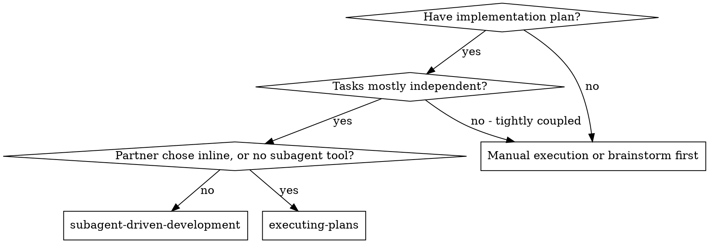
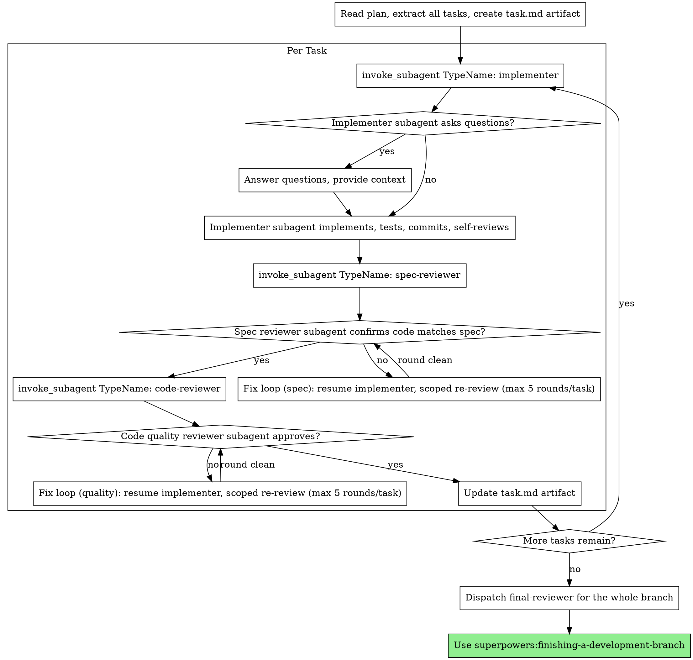

# Subagent-Driven Development

Execute plan by dispatching fresh subagent per task, with two-stage review after each: spec compliance review first, then code quality review.

**Why subagents:** You delegate tasks to specialized agents with isolated context. By precisely crafting their instructions and context, you ensure they stay focused and succeed at their task. They should never inherit your session's context or history — you construct exactly what they need. This also preserves your own context for coordination work.

**Core principle:** Fresh subagent per task + two-stage review (spec then quality) = high quality, fast iteration

**Narration:** between tool calls, narrate at most one short line — the
ledger and the tool results carry the record.

**Continuous execution:** Do not pause to check in with your human partner between tasks. Execute all tasks from the plan without stopping. The only reasons to stop are the four named below, or all tasks complete. "Should I continue?" prompts and progress summaries waste their time — they asked you to execute the plan, so execute it.

**Rulings, not stalls.** A running plan does not wait on a human. Conflicts,
ambiguities, plan defects, a cap you would have asked to exceed — decide
them. The spec is the binding authority, the plan is its argument, and your
judgment settles what neither answers. Record every decision in the ledger as
`Ruling: <what you decided> — <why> — <what it costs if wrong>`, and keep
going. A wrong ruling costs rework your human partner can see and undo; a
session parked on a question costs their whole day and buys nothing.

Four things stop you, and only these: an irreversible or destructive
operation; a security-sensitive action; a side effect outside this worktree
that norms say you ask about first (a merge, a push to a shared branch, a
publish); and a plan so broken that every path forward is a guess. For those,
stop and ask.

Your human partner may steer while the plan runs — a message, a comment on the plan or another artifact, stopping a subagent you dispatched, or, in subagent-driven development, an instruction sent straight to an implementer (a CLI `@` message) that its report mentions. That is their instruction, not your ruling: apply it, ledger it as `Task <N>: partner instruction: <one-liner>`, and rule only where it conflicts with work already finished. One that changes scope or asks you to stop — a stopped subagent is one — is handled like the four stops.

## When to Use

**vs. Executing Plans (inline):**
- Fresh subagent per task (no context pollution) instead of one context doing every task
- Review after each task (spec compliance + code quality) instead of only at the end
- Costs a fresh context per task and per review; inline costs one context plus one final reviewer
- Both run in this session, share the same plan workspace and ledger, and never pause between tasks

Plans come from **superpowers:writing-plans**. This skill executes one.

## The Process

## Setup

Ensure the work happens in an isolated workspace: use
superpowers:using-git-worktrees to create one or verify the existing one.
Never start implementation on a main/master branch without your human
partner's explicit consent.

Approvals can pause an unattended run. If your commands run in a terminal sandbox, a commit may need to run outside it — the sandbox can keep `.git` read-only — and that waits for your human partner's approval unless an allow rule covers it; where their settings review commands or edits, more waits. Before Task 1, tell your human partner in one line what may wait for approval: the git commands you and your reviewers run on every task (`git rev-parse`, `git rev-list`, `git merge-base`, `git diff`, `git log`, `git status`), the plan's test commands, `git add` and `git commit`, and — where edits pause for review — every file edit. Never change their permission settings yourself. This is a notice, not a stop: start Task 1.

Conversation memory does not survive compaction. In real sessions,
controllers that lost their place have re-dispatched entire completed task
sequences — the single most expensive failure observed. Track progress in
a ledger file, not only in the task.md artifact.

- Each plan owns a workspace: a git-ignored directory under `<repo-root>/.superpowers/sdd/`, home to every file for THIS plan — its ledger. Another plan's directory is never yours to read or write. Resolve it at skill start:
  1. Write the plan's path the way the ledger names it: relative to the repository root (`git rev-parse --show-toplevel`), with forward slashes, or absolute if the plan lives outside the repository. Normalize a ledger's first line the same way before you compare it, and on Windows compare without regard to case.
  2. Try `.superpowers/sdd/<plan-basename>/`, then `<plan-basename>-<name of the plan's parent directory>/`, then that name with `-2`, `-3`, … appended. A candidate is yours if it has no `progress.md`, or if its `progress.md` first line names your plan; one whose first line names another plan belongs to that plan — try the next.
  3. Create and extend files here with your file tools, never with shell redirection: create `progress.md` with `write_to_file`, and append each ledger line with `replace_file_content` anchored on the ledger's current last line — never rewrite the whole ledger. If a directory is missing, create each level with the shell's own command and retry. Then, if `<repo-root>/.superpowers/.gitignore` does not exist, create it with the single line `*`.
  4. If the platform refuses to read or write the ledger (the IDE's strict mode hides git-ignored files), keep the ledger in the task.md artifact instead; if that is refused too, keep the ledger lines in your messages. Either way, tell your human partner at the start that another executor, or another conversation, cannot resume from it.
- Check for this plan's ledger at `<workspace>/progress.md`. If its first
  line names your plan file, tasks with a `Task <N>: complete` line are DONE
  — do not re-dispatch them; resume at the first task without one. A task
  whose last line is a fix round is mid-loop: resume the loop at the next
  round. A ledger whose first line names a different plan file — or a stray
  ledger at the old flat path `.superpowers/sdd/progress.md` — is another
  plan's progress: leave it in place and start your own, fresh.
- Create the ledger with its identity as the first line:
  `# SDD ledger — plan: <plan file path>`.
- The ledger is your recovery map: the commits it names exist in git even
  when your context no longer remembers creating them. After compaction,
  trust the ledger and `git log` over your own recollection.
- `git clean -fdx` will destroy the workspace (it's git-ignored scratch); if
  that happens, recover from `git log`.
- Each implementer dispatch gets a ledger line, in the same step as your other bookkeeping: `Task <N>: dispatched implementer <conversation ID> (base <base7>[, round <R>])` — the bracketed part only for a rounds 4-5 dispatch. When you kill an implementer yourself (rounds 4-5), ledger `Task <N>: killed implementer <conversation ID> (round <R> takeover)` in the same step as the new dispatch line. If a dispatch result shows no conversation ID, write `(id unavailable)` in its place; that task resumes by a fresh dispatch. A task whose last line is `dispatched` is in flight: list your subagents (`manage_subagents`, `Action: "list"`) and find that conversation. Running — wait for its report. Idle — its report was lost with your context, so ask it to repeat the report (`send_message`). Errored — dispatch a fresh implementer with the task text, telling it that commits after BASE are its predecessor's and that its first action is `git status`. Killed, with no kill line of yours for it — your human partner stopped it: that is their instruction, not a failure. Ledger `Task <N>: partner instruction: stopped implementer` and handle it like the four stops; never re-dispatch it on your own.

The roles ship as bundled agents — `implementer`, `implementer-flash`, `implementer-pro`, `spec-reviewer`, `code-reviewer`, `re-reviewer` and `final-reviewer` (defined in the plugin's `agents/` directory). No registration step: dispatch them by TypeName. Bundled agents are documented on Antigravity 2.0 and the CLI and observed working on 2.0; the IDE has no `invoke_subagent`, so there this skill takes the no-subagent-tool path below. If a dispatch is rejected with an unknown TypeName, dispatch it once more as `superpowers:<name>`. If that is rejected too, the plugin's agents are not being discovered — verify the plugin installation, then read the plugin's `agents/<name>.md` (`../../agents/<name>.md` from this skill's folder), dispatch the built-in `self` subagent with that file's body, below its closing `---`, pasted ahead of the prompt, and ledger `Setup: self subagent for <name> (bundled agent unavailable)`. If you have no subagent tool, or you cannot read the plugin's agent file, this skill cannot run here, and the method was your human partner's choice. Ask once with `ask_question` — at Setup if you have no subagent tool, or at the first dispatch that exhausts these steps, before any work on that task — whether to run the plan inline with superpowers:executing-plans (same workspace and ledger, one final review) or to stop so they can fix the installation. Ledger the answer as `Setup: <answer>`; for inline, load superpowers:executing-plans and continue from this ledger. A running plan never switches executors on its own.

**Workspace isolation per role:**

| Role | Workspace Mode | Why |
|------|---------------|-----|
| Implementer (any tier) | `Workspace: "inherit"` | Works in your checkout, one at a time, so its commits land on the working branch the reviewers read |
| Spec reviewer | `Workspace: "inherit"` | Read-only — only inspects code |
| Code reviewer | `Workspace: "inherit"` | Read-only — only inspects code |
| Re-reviewer | `Workspace: "inherit"` | Read-only — verifies the fix diff |
| Final reviewer | `Workspace: "inherit"` | Read-only — reviews the whole branch |

Read the plan once, extract all tasks with full text and context, and
create a `task.md` artifact tracking each task's status — it belongs with your other artifacts, never in the repository or under `scratch/`. If the plan names
a Spec, read that too: the spec is the authority the plan argues from, and
conflicts inside the plan resolve against it. A plan with no reachable spec
gets a ledger note saying so — rulings made without one are provisional.

Ledger a `Plan map:` of the task-heading lines — each task's first and last line, taken from your read or from `git grep -n --no-index -E "^#+[[:space:]]+Task[[:space:]]+[0-9]+" -- <plan>` — and remap it if the plan changes. Implementers and spec reviewers get their task as that line range of the plan's absolute path, not as pasted text; interfaces from earlier tasks, rulings and parked-finding pointers are still pasted. Paste the task's full text instead when the plan lives outside the repository or `git check-ignore <plan>` prints its path.

### Pre-Flight Plan Review

Read `references/preflight.md` with `view_file` now.

## Model Selection

No documented dispatch argument sets the model, so an implementer's tier comes from the bundled agent's frontmatter: you choose the tier by choosing the TypeName — `implementer-flash` (`model: flash`), `implementer` (your session's model) or `implementer-pro` (`model: pro`). `flash` and `pro` are tiers; which models they are is not documented. If you cannot tell which model your session runs, treat it as Flash. Use the least powerful tier that can handle each role to conserve cost and increase speed.

- **Transcription** — the task's plan text contains the complete code to write — **and single-file mechanical fixes:** `implementer-flash`.
- **Tasks worked from prose, integration and judgment tasks** (multi-file coordination, pattern matching, debugging): `implementer`.
- **Architecture and design tasks** (design judgment or broad codebase understanding): `implementer-pro` if your session runs a Flash model; otherwise `implementer`.
- **BLOCKED on reasoning, and fix-loop rounds 4-5:** one tier above the implementer that got stuck. Stuck on `implementer-flash`: `implementer` if your session runs above Flash, else `implementer-pro`. Stuck on `implementer`: `implementer-pro` if your session runs Flash; on a Pro-tier or non-Gemini session no TypeName is a step up, so re-dispatch `implementer` with more context or a smaller task. Stuck on `implementer-pro`: a fresh `implementer-pro`.
- **Per-task reviews:** `spec-reviewer`, `code-reviewer` and `re-reviewer` run on your session's model.
- **The final whole-branch review** goes to `final-reviewer`, which ships at the Pro tier (`model: pro`), not your session's model.

**Always pick the tier; without one, the implementer inherits your session's model.**

**Turn count beats token price.** Wall-clock and context cost scale with how many turns a subagent takes, and the cheapest models routinely take 2-3× the turns on multi-step work — costing more overall.

## The Task Loop

Read `references/batching.md` with `view_file` now.

For each task, in plan order:

1. Record BASE (`git rev-parse HEAD`) before dispatching — the review range and fix-round diffs need it. Fill `implementer-prompt.md`'s dynamic template with the task's plan range (Setup's `Plan map:`) and scene-setting context, choose the implementer's tier by Model Selection (it sets the TypeName or the `Model` key), and dispatch: `invoke_subagent(Subagents: [{TypeName: "implementer", Role: "Implement Task <N>", Prompt: <filled template>, Workspace: "inherit"}])`.
2. Record the implementer's agent identity from the dispatch result (its conversation ID) — fix-loop rounds 1-3 resume this agent — and ledger the dispatch line (Setup).
3. When the implementer reports DONE, check the range (below), then run the two review stages in order: `spec-reviewer` first, then `code-reviewer` (dispatch templates in Prompt Templates below). Findings from either stage enter The Fix Loop.

**Check the range before every review dispatch** — each stage, each re-review, the final review: run `git rev-list --left-right --count <BASE>...<HEAD>` (`Cwd`: the repository root). `<HEAD>` is your checkout's `git rev-parse HEAD` once the implementer reports, or once you have committed its reported work. It must print `0` and then a number above `0`: a first number above `0` means HEAD does not descend from BASE; a second number of `0` means the range is empty. Either way, do not dispatch: find where the commits went first. In a fix round whose implementer committed nothing, the check fails by design: count the round with its findings NOT ADDRESSED and do not dispatch the re-review. A reviewer's `RANGE INVALID` reply is the same failure.

**Never:**
- Dispatch multiple implementation subagents in parallel (conflicts)
- Make a subagent read the whole plan file — hand it its task's line range (Setup)
- **Start code quality review before spec compliance is ✅** (wrong order)

### Handling Implementer Status

Read `references/handling-reports.md` with `view_file` now.

### Constructing Reviewer Prompts

Read `references/reviewer-prompts.md` with `view_file` now.

### The Fix Loop

Read `references/fix-loop.md` with `view_file` now.

### Complete the task

When the review comes back clean — or every open finding is parked with a
ruling at the cap — append the completion line to the ledger in the same
message as your other bookkeeping:

- `Task <N>: complete (commits <base7>..<head7>, review clean)`
- `Task <N>: complete (commits <base7>..<head7>, <K> parked)` after a
  tripped breaker

Then mark the task complete in the task.md artifact and move on. Never move to the next task while
the review has open Critical/Important issues that are neither fixed nor
parked-with-ruling at the cap.

## Async Operations

Read `references/async-operations.md` with `view_file` now.

## Final Review

Read `references/final-review.md` with `view_file` now.

## Finish

Read `references/finish.md` with `view_file` now.

## Common Rationalizations

| Excuse | Reality |
|--------|---------|
| "Close enough on spec compliance" | Reviewer found spec gaps = not done. Fix or hit the cap and adjudicate — those are the only exits. |
| "I'll fix it myself, dispatching is overhead" | Controller fixes pollute your context and skip review. Resume the implementer with `send_message`. |
| "One more round will converge" | Past the cap, rounds don't converge — the failure is structural. Adjudicate and route. |
| "The reviewer will just find something new anyway" | Scoped re-reviews verify fixes; they cannot wander. New findings on untouched code go to the ledger, not the loop. |
| "This finding is obviously wrong, I'll drop it" | You adjudicate only at the cap, and every ruling is a ledger entry. Silent discards are forbidden. |
| "The fix was small, skip the re-review" | Unreviewed fixes are how regressions land. Every round ends with a scoped re-review. |
| "Reviews slow the loop down" | The loop without reviews is just unverified churn. Reviews are the loop's brakes and steering. |
| "Ledger bookkeeping is overhead" | The ledger is what survives compaction. Controllers without one have re-dispatched entire completed task sequences. |
| "The implementer spawned its own reviewer — free extra assurance" | It's a duplicate seat reviewing the same diff; the task review is the gate. A worker-spawned reviewer is a defect to flag, not rigor. |

## Prompt Templates

- `implementer-prompt.md` (located in the `subagent-driven-development` skill directory) — dynamic dispatch template — the static role lives in `agents/implementer.md`
- `spec-reviewer-prompt.md` (located in the `subagent-driven-development` skill directory) — dynamic dispatch template — the static role lives in `agents/spec-reviewer.md`
- `code-quality-reviewer-prompt.md` (located in the `subagent-driven-development` skill directory) — dynamic dispatch template — the static role lives in `agents/code-reviewer.md`
- `re-review-prompt.md` (located in the `subagent-driven-development` skill directory) — dynamic dispatch template — the static role lives in `agents/re-reviewer.md`
- `code-reviewer.md` (located in the `requesting-code-review` skill directory) — dynamic dispatch template, also the final review's template (dispatched to the bundled `final-reviewer`) — the static roles live in `agents/code-reviewer.md` and `agents/final-reviewer.md`

## Example Workflow

Read `references/example-workflow.md` with `view_file` now.

