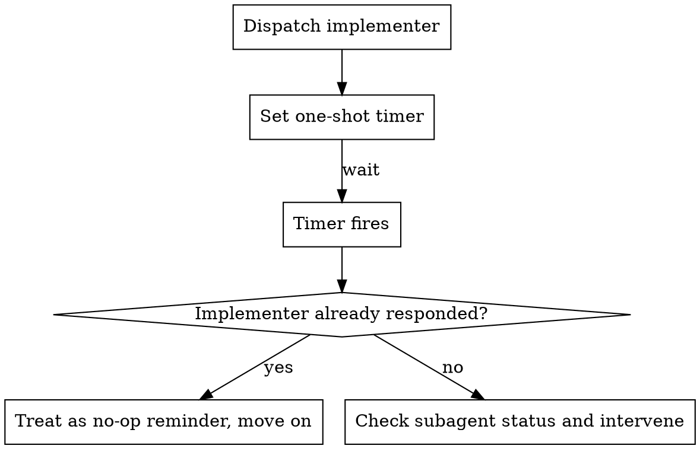

# Async Operations

### Background Task Management

Implementers wait for their own long runs and collect them before they report (see `agents/implementer.md`, Long-Running Commands); an implementer's turn ending is what reaches you as its report.

### Agent Communication

Use `send_message` to communicate with subagents — running or idle. An idle (finished, not killed or errored) subagent re-awakens on receipt and retains its full context.

**Answering questions mid-flight:**
- When an implementer asks a question, use `send_message` with the implementer's conversation ID — this works whether it's still running or has gone idle
- Don't re-dispatch a new subagent just to answer a question — the original implementer has context

**Providing additional context:**
- If you realize an implementer needs more information after dispatch, use `send_message` to send it
- The implementer receives it as a message and can incorporate it into their work

**When to use `send_message` vs. re-dispatch:**
- Subagent (running or idle) needs info → `send_message` — an idle subagent resumes with its context intact
- Subagent reported NEEDS_CONTEXT → send the missing context via `send_message`; re-dispatch a fresh subagent only if the original was killed or in an error state
- Subagent reported BLOCKED → assess blocker, possibly resume with more context via `send_message`, break the task into smaller pieces, or re-dispatch one tier up (Model Selection)

**If subagent asks questions:**
- Answer clearly and completely
- Provide additional context if needed
- Don't rush them into implementation

### Timeout Protection

Use `schedule` as a safety net for complex tasks:



- Set a one-shot timer when dispatching implementers for complex tasks (5 minutes for standard tasks, 10 for complex ones)
- If the timer fires before the implementer responds, check status and intervene if needed
- The timer's Prompt fires unconditionally at the scheduled time — if the implementer already responded, treat the firing as a no-op reminder and move on; no cancellation is documented or needed

**For test suites expected to take 5+ minutes**, use a recurring schedule instead of a one-shot timer:
```
schedule(CronExpression: "*/2 * * * *", MaxIterations: "5", Prompt: "Check implementer status for Task N")
```

### Subagent Monitoring

Use `manage_subagents` to track running subagents:

- `Action: "list"` — check which subagents are still running before dispatching the next task
- `Action: "kill"` — terminate stuck subagents that haven't responded after timeout

Don't poll in a loop — the system notifies you when subagents complete. Use `manage_subagents` only when you need an explicit status check (e.g., before cleanup or when a timer fires).
